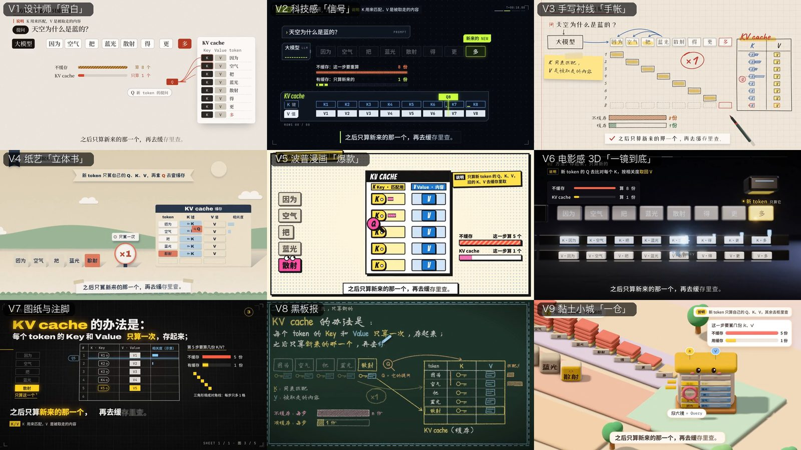

# lanshu-create-ai-presenter-video

[English](README.md) | [简体中文](README.zh-CN.md) | **日本語**

[](https://agentskills.io)


[](explainer/STYLES.md)
[](https://hyperframes.heygen.com)
<br>
[](https://github.com/cclank/lanshu-create-ai-presenter-video/actions/workflows/validate.yml)
[](LICENSE)
[](https://github.com/cclank/lanshu-create-ai-presenter-video/releases/latest)
[](https://www.python.org/)
[](https://ffmpeg.org/)
[](https://nodejs.org/)
[](https://github.com/cclank/lanshu-create-ai-presenter-video/stargazers)
<br>
[](https://x.com/LufzzLiz)
[](https://x.com/LufzzLiz)

> トピックや台本を、検証済みですぐに公開できる解説動画に変えます。1 枚の許諾済みポートレートから作るデジタルヒューマンが解説するか、12 種類の解説スタイルのいずれかで画面上に演じられ、普段お使いのコーディングエージェントによって制作が進みます。

`lanshu-create-ai-presenter-video` は、AI エージェントに解説動画の制作全工程を進めさせる [Agent Skill](https://agentskills.io) です。**プレゼンタールート** では、台本、ナレーション、プレゼンターの生成、リップシンク、字幕とキーワードのモーショングラフィックス、編集、レンダリング、品質保証までを行います。**スタイルルート** では、ナレーションが 12 種類のスタイル（ビジュアル 9 種、ナラティブ 3 種）のいずれかでシーンごとに演じられ、単語単位でタイミングを取ったストーリーからレンダリング済みの映像までを作ります。すべての段階はディスク上の証拠によってゲートされ、出力がデコードとラウドネスのチェックに合格するまで何も納品されません。

## ハイライト

- **ハーネスに依存しない。** Claude Code、Codex、Gemini CLI、Cursor、OpenCode、GitHub Copilot、その他の Agent Skills クライアントで読み込める標準の `SKILL.md` です。ファイルを読み、シェルコマンドを実行できるエージェントであれば、そのまま従うことができます。
- **プロバイダーに依存しない。** プレゼンタールートでは、音声、プレゼンター動画、リップシンク、音声認識が実行時に機能に応じて選択されます。各ジョブは、実際に使用したプロバイダー、モデル、パラメーター、タスク ID を記録します。スタイルルートでは MiniMax で音声を生成する（単語のタイムスタンプは音声エンジンから取得）か、別の場所で音声生成または録音したナレーションを使います。
- **演じられる 12 種類の解説スタイル。** 9 種類のビジュアルスタイル（エディトリアル、テック HUD、ノート、紙の飛び出す絵本、ポップコミック、3D ワンテイク、製図シート、黒板、粘土の町）に加え、3 種類のナラティブスタイル（推演、事件ファイル、生活シーンのシットコム）があります。それぞれに再利用可能なキット、スターター、サンプルプロジェクトが用意されています。
- **音声に固定されたタイムライン。** 承認されたナレーションが、プレゼンターの動き、字幕、カット、最終的な尺のマスタークロックになるため、リップシンクとシーンの境界がずれません。
- **証拠でゲートされるワークフロー。** `intake` から `verified` までの 8 つの制作状態は、手動で宣言するのではなく、成果物から算出されます。
- **コストのガードレール。** パイロット優先の生成、最初の有料呼び出し前の明示的な課金説明、再試行の上限、そして重複課金を避けるためのタスク ID による復旧を備えています。
- **検証済みの納品。** マスター版と共有用のエンコードは、ファイルを公開する前に完全にデコードされ、ラウドネスがチェックされます。

## 2 つのルート

| ルート | 動画の内容 | 用意するもの | 有料の生成 | フォーマット |
|---|---|---|---|---|
| **プレゼンター** | デジタルヒューマンが解説し、字幕とキーワードのグラフィックスがそれを補います | トピックまたは台本 + 許諾済みのポートレート | 音声 + プレゼンター動画 | 任意。デフォルトは 9:16 |
| **スタイル解説** | プレゼンターなし。ナレーションの各フレーズが 12 種類のスタイル（ビジュアル 9 種、ナラティブ 3 種）のいずれかで画面上に演じられます | トピックまたは台本（または自分で録音したナレーション） | 音声のみ（自分のナレーションを使う場合はなし） | 16:9 |

エージェントはリクエストからルートを推測するか、スタイルギャラリーを示して一度だけ尋ねます。すべてのスタイルは共通の取り決め —
単語単位でタイミングを取った字幕、チャプターチップ、演出付きの締めの一言、1 フレームのまとめ — に従います。9 種類はビジュアルスタイルで、
アイデアの演じ方が異なります：エディトリアルペーパー、テック HUD、ノートとペン、紙の飛び出す絵本、ポップコミック、3D ワンテイク、
製図シート、黒板、そして粘土の町です。以下は、同梱の KV キャッシュ解説動画の同じ場面を 9 種類すべてで示したものです：



3 種類はナラティブスタイルで、見た目に語り方が伴い、台本はその推奨される流れを活用できます：**推演**
（1 つのキャンバス上で導出し、数式と図形を色で結び付けます）、**案卷**（証拠ボードで調査し、
異常から事件の解決までをたどります）、そして **小剧场**（生活シーンのシットコム：誤解、原因を示す請求書や行列、
そしてアナロジーを本来の用語に対応させる 1 文）です。以下は、同じ KV キャッシュのトピックを 3 つの語り方で伝えたものです：


新しいトピックは、数個のコマンドで任意のスタイルの再生可能なドラフトになります。ナレーション、単語のタイミング、字幕、チャプター、
締めの一言、まとめ、サウンドが生成され、その後エージェントが各行のシーンを演じます。スタイルの選び方は
[`explainer/STYLES.md`](explainer/STYLES.md) を、ワークフローは
[`references/styled-explainer.md`](references/styled-explainer.md) を参照してください。後者には、デジタルヒューマンを
スタイル解説動画に登場させるオプションの方法も含まれています。

## 用意するもの

| 入力 | 必須 | 備考 |
|---|---|---|
| トピックまたは完成した台本 | はい | トピックからは 45〜75 秒の台本が作られます。用意した台本は本来の長さが保たれます。 |
| プレゼンター画像 | プレゼンタールート | はっきり写った成人のプレゼンター 1 人で、画像の使用権が確認されているもの。スタイル解説では不要です。 |
| 音声サンプル | いいえ | クローンについて明示的な許可がある場合にのみ使用されます。それ以外の場合は既製の音声が選択され、収録されます。 |
| 補足メディア | いいえ | 画面録画、画像、B ロール、ブランドアセットなど。話している内容を裏付けたり分かりやすくしたりする箇所で使われます。 |
| 納品の希望 | いいえ | プラットフォーム、尺、アスペクト比、スタイル、ウォーターマーク、音楽、コールトゥアクション。 |

## 仕組み

プレゼンタールート：

```text
Topic or script + authorized portrait
        │
        ▼
Lock script and full narration ──► narration becomes the master clock
        │
        ▼
Low-cost presenter pilot
        │
        ▼
Presenter generation (split at real pauses when a provider caps duration)
        │
        ▼
Audio-driven edit: captions, keyword graphics, cover, close
        │
        ▼
Technical and visual QA
        │
        ▼
Master, share copy, contact sheet, and delivery report
```

スタイルルート：

```text
Topic or script ──► choose a style (menu + galleries, or drafts in the nine visual styles)
        │
        ▼
Script written for the style ──► voice with word timestamps (or your own narration)
        │
        ▼
Draft film from the style's starter: captions, chapters, closing line, recap, sound
        │
        ▼
Storyboard ──► every line performed on screen, on its words
        │
        ▼
QA (check, stillness, cover) ──► render ──► master, share copy, subtitles, delivery report
```

各状態では、ジョブが次に進む前に証拠が必要です。`check_state.py` はジョブの成果物から状態を算出します：

| 状態 | 必要な証拠 |
|---|---|
| `intake` | ジョブの作成 |
| `content_locked` | 合格したプリフライトレポート、台本、ビートシート |
| `audio_locked` | デコード可能な最終ナレーション、ASR レポート |
| `visual_plan_locked` | タイムライン、ストーリーボード、承認済みのプラン |
| `presenter_generated` | 記録されたプレゼンターの機能、選択された動画、ビジュアルレビュー |
| `composition_checked` | コンポジションレポート |
| `rendered` | 映像と音声を含むデコード可能なレンダリング |
| `verified` | マスター版、共有用コピー、出力ラウドネスが合格した納品レポート |

スタイルルートでは、`audio_locked` には音声付きの `story.json` も必要です（`--dry` のドラフトは対象外です）。また
`presenter_generated` には、プレゼンター動画の代わりに、演じられた映像とそのビジュアルレビューによって到達します。

## 要件

- Agent Skills ハーネス、またはファイルを読み、シェルコマンドを実行できる任意のコーディングエージェント。
- Python 3.9 以降、`ffprobe` 付きの FFmpeg、Bash、`jq`、`awk`、`sed`。
- プレゼンタールートの場合：音声合成、プレゼンター動画の生成、リップシンクの機能のうち少なくとも 1 つずつへのアクセス（クラウド CLI、API、またはローカルモデル）。字幕、モーショングラフィックス、最終レンダリング用に、オプションで HyperFrames などの決定論的なタイムラインコンポジター。
- スタイル解説の場合：Node.js（HyperFrames は `npx` で実行されます）、`rsync`、`numpy` を備えた Python（サウンドベッド用。
  `PYTHON` でそれを指定します）、そして音声とその単語タイムスタンプ用の MiniMax API キー（`MINIMAX_API_KEY`）、または自分で
  録音したナレーション。

## インストール

リポジトリのディレクトリがそのままスキルになります。ハーネスのスキルディレクトリにクローンし、フォルダー名は `lanshu-create-ai-presenter-video` のままにしてください。Agent Skills の仕様では、フォルダー名がスキルの `name` と一致している必要があります。

| ハーネス | スキルディレクトリ | 明示的な呼び出し |
|---|---|---|
| Claude Code | `~/.claude/skills/` またはプロジェクトレベルの `.claude/skills/` | `/lanshu-create-ai-presenter-video` |
| Codex | `~/.codex/skills/` | `$lanshu-create-ai-presenter-video` |
| その他の Agent Skills クライアント | [クライアント一覧](https://agentskills.io/clients) からリンクされている各クライアントのドキュメントを参照 | クライアントごとに異なる |

たとえば Claude Code の場合：

```bash
git clone https://github.com/cclank/lanshu-create-ai-presenter-video.git \
  ~/.claude/skills/lanshu-create-ai-presenter-video
```

更新するには、インストールしたディレクトリで `git pull` を実行します。複数のハーネスを使っている場合は、それぞれのスキルディレクトリに一度ずつクローンしてください。

タグ付きのバージョンと、そのまま展開できるスキルの ZIP は [Releases](https://github.com/cclank/lanshu-create-ai-presenter-video/releases) で入手できます。バージョン履歴は [CHANGELOG.md](CHANGELOG.md) を参照してください。

**Agent Skills に対応していないエージェント。** リポジトリを任意の場所にクローンし、次の内容でセッションを開始します：

```text
Read /path/to/lanshu-create-ai-presenter-video/SKILL.md and follow its workflow exactly.
```

## クイックスタート

ほとんどのハーネスは説明文からスキルを自動的に選択するので、作りたい動画を説明するだけで構いません：

```text
Turn this script and portrait into a 30-second 16:9 presenter video with live captions.
```

スタイル解説の場合、まだスタイルを知らなくても大丈夫です。尋ねれば、エージェントが 12 種類を画像付きで示し、
トピックに合うものをいくつか勧めてくれます：

```text
Make a 40-second explainer about RAG, no presenter. Which styles are there?
```

確実にスキルを選択させるには、上の表にある明示的な呼び出しを使ってください。スキルはリクエストの言語で動作します。

エージェントは同梱のスクリプトを自ら実行します。ジョブを手動でセットアップするには、`SKILL_DIR` をインストール先に向けます：

```bash
SKILL_DIR=~/.claude/skills/lanshu-create-ai-presenter-video

python3 "$SKILL_DIR/scripts/init_job.py" \
  --job-dir ~/Videos/my-presenter-video \
  --presenter-image ~/Pictures/presenter.png \
  --topic "Context engineering in one minute" \
  --duration 60 \
  --aspect 9:16 \
  --rights-confirmed \
  --adult-presenter-confirmed
```

`job.json` で手動レビューとアップロードの承認を完了してから、プリフライトを実行します：

```bash
python3 "$SKILL_DIR/scripts/preflight.py" ~/Videos/my-presenter-video/job.json
```

各段階の後で、その成果物を `job.json` に記録し、チェッカーに状態を算出させます：

```bash
python3 "$SKILL_DIR/scripts/check_state.py" ~/Videos/my-presenter-video/job.json --write
```

ジョブディレクトリから手動でスタイル解説を作る場合（`X=$SKILL_DIR/explainer`）：

```bash
python3 "$SKILL_DIR/scripts/init_job.py" --job-dir . --route styled --explainer-style v8-chalkboard --topic "RAG in 40 seconds"
python3 "$X/tools/story.py" story              # story/script.md → voice + word times → story/story.json
bash "$X/tools/new_film.sh" v8-chalkboard story film   # a playable draft; perform each line in film/beats.js
python3 "$X/tools/qa.py" film qa/film          # check, stillness, snapshots, cover
bash "$X/tools/render.sh" film rag outputs     # master, share copy, subtitles
```

## スクリプト

| スクリプト | 用途 |
|---|---|
| `init_job.py` | 自己完結したジョブディレクトリを作成し、すべての入力をそこにコピーして、ジョブからの相対パスを記録します。 |
| `preflight.py` | 入力、手動レビュー、承認を検証し、ローカルのエラーとリモート生成の阻害要因を区別します。 |
| `plan_segments.py` | プロバイダーがリクエストや参照音声の長さに上限を設けている場合に、確定したナレーションを ASR の実際の間で分割します。 |
| `check_state.py` | 証拠に基づく制作状態を算出し、記録された状態が実際を上回っている場合は 0 以外で終了します。 |
| `finalize_delivery.sh` | マスター版と共有用のエンコードを作成し、完全なデコード、納品時のラウドネス、黒画面やフリーズしたフレームを検証してから、コンタクトシートとレポートとともに公開します。 |

## 解説ツール

`explainer/tools/` 配下にあり、スタイルルートで使用します：

| ツール | 用途 |
|---|---|
| `story.py` | `script.md` → 行ごとの MiniMax 音声とエンジンの単語タイムスタンプ → `story.json`。自分のナレーションには `--audio`、無音のドラフトには `--dry`、プランと推定の長さの確認には `--check` を使います。 |
| `new_film.sh` / `new_topic.sh` | スタイルのスターターから再生可能な映像を作ります（または 9 種類のビジュアルスタイルのドラフトを一度に作ります）。 |
| `docs.py` | ストーリーから台本、ビートシート、タイムライン、ストーリーボードの表を作ります。 |
| `qa.py` | `hyperframes check`、全チャプターでのスナップショット、静止ペア、カバーフレーム、コンポジションレポート。 |
| `render.sh` | レンダリングし、`finalize_delivery.sh` で仕上げ、字幕（SRT）を書き出します。`DRAFT=1` でスマートフォン向けの 720p レビュー用コピーを作ります。 |
| `srt.py`、`still_grid.py`、`fonts.py`、`sync.sh`、`stamp.py` | 字幕、3×3 のスタイル比較静止画、フォントのサブセット、プロジェクトの配管処理。 |

## リファレンスガイド

エージェントは対応する段階に到達したときにだけ各ガイドを読み込むため、コンテキストの使用量を低く抑えられます。

| ガイド | 内容 |
|---|---|
| [`generation.md`](references/generation.md) | インテーク、台本とナレーション、機能の選択、課金ゲート、セグメントの計画、プレゼンターのプロンプト |
| [`editing.md`](references/editing.md) | タイムラインの取り決め、セグメントのつなぎ目、オープニングとクロージング、字幕、キーワードのグラフィックス、プレビューと書き出し |
| [`qa-recovery.md`](references/qa-recovery.md) | 受け入れゲートと、リップシンク、同一性、つなぎ目、ラウドネス、リモートタスクの復旧手順 |
| [`styled-explainer.md`](references/styled-explainer.md) | スタイル解説ルート：ストーリーパイプライン、スタイルのスターター、シーンの演出、デジタルヒューマンを追加するオプションの方法 |
| [`explainer/STYLES.md`](explainer/STYLES.md) | スタイルのメニューとギャラリー、よく使われる言葉 → スタイル、各スタイルのナレーションの書き方 |
| [`explainer/KITS.md`](explainer/KITS.md) | キットの取り決め、美的なベースライン、スターター、ツール |
| [`explainer/GOTCHAS.md`](explainer/GOTCHAS.md) | スタイルを構築する中で遭遇した HyperFrames の落とし穴 |

## リポジトリの構成

```text
lanshu-create-ai-presenter-video/
├── SKILL.md                 # Skill entry point: metadata and workflow
├── README.md
├── README.zh-CN.md
├── agents/
│   └── openai.yaml          # Codex display metadata; other harnesses ignore it
├── assets/
│   └── job.template.json    # Job manifest template
├── references/              # Stage guides loaded on demand
├── scripts/                 # Job setup, gates, segment planning, delivery
├── explainer/               # Styled explainer engine: core runtime, twelve style kits + starters, tools, examples
│   ├── STYLES.md            # Style chooser with the gallery
│   ├── KITS.md              # The kit contract and tools
│   ├── kits/<style>/        # One look per style, and starter/ = the film minus the topic
│   ├── stories/             # Example scripts (KV cache) and a draft test story
│   ├── examples/kv-cache/   # The finished KV cache film in each style
│   └── tools/               # story.py, new_film.sh, qa.py, render.sh, srt.py, …
└── tests/
    ├── smoke.sh             # End-to-end test with synthetic media
    └── explainer_smoke.sh   # Styled route: intake, story, starter sync, state
```

## デフォルト設定

| 設定 | デフォルト |
|---|---|
| フォーマット | 9:16、1080×1920、30 fps（スタイル解説：16:9、1920×1080、30 fps） |
| 尺 | トピックからは 45〜75 秒。用意した台本は本来の長さ |
| 音声 | 許諾済みのサンプルが提供されない限り既製の音声。スタイルルート：MiniMax `Chinese (Mandarin)_Reliable_Executive`、速度はスタイルごとに設定 |
| 構成 | フック、2〜4 個の内容ビート、簡潔な締め |
| 音楽とコールトゥアクション | リクエストがない限りオフ |
| ラウドネス | −16 LUFS ±0.5 LU、トゥルーピーク ≤ −1 dBTP。`PROGRAM_LUFS` で上書き可能 |

## 安全性とコストの管理

- 画像の権利とプレゼンターが成人であることは、アップロード前に確認されます。
- 音声のクローンには明示的な許可が必要で、画像から音声が推測されることはありません。
- 最初の有料呼び出しの前に、エージェントはアップロードする内容、リクエストする秒数、既知の価格、パイロットの規模、再試行の上限を提示します。
- プロバイダーが長さに上限を設けている場合、見積もりにはセグメント計画のリクエスト秒数の合計が使われます。
- 中断されたリモートタスクは、再送信の前に保存されたタスク ID でポーリングされます。
- 有料の候補が 3 回却下されると作業は停止し、繰り返し起きた失敗と残りの選択肢がまとめて報告されます。
- スタイルルートで唯一の有料呼び出しは音声です。1 行につき 1 回の呼び出しでキャッシュされるため、編集時にはその行だけが再生成されます。9 種類のビジュアルスタイルのドラフトには追加費用はかかりません。

## プライバシー

- リポジトリには API キー、アクセストークン、署名付き URL、ユーザーのメディアは含まれていません。
- プロバイダーへのリクエスト記録は、認証情報や有効期限付きの URL を含まない形で保存されます。
- プリフライトと納品のレポートには、ファイル名またはジョブからの相対パスのみが保存され、マシンの絶対パスが保存されることはありません。
- スタイル解説は、フォントのサブセットを Google Fonts と jsDelivr からダウンロードします（使用する文字のみ）。単語のタイミングは
  音声プロバイダー自身のタイムスタンプから取得するため、音声認識モデルはインストールされません。スナップショットは
  `--describe false` で撮影されるため、フレームはローカルに留まります。

## テスト

スモークテストは、リモートサービスを一切呼び出さずに、合成ジョブを `intake` から `verified` まで進めます。FFmpeg、`jq`、Python 3.9 以降が必要です：

```bash
bash tests/smoke.sh
bash tests/explainer_smoke.sh   # styled explainer; also needs Node.js and rsync
```

CI は、すべての push とプルリクエストに対して、メタデータの検証、移植性チェック、解説エンジンの構文チェック、そして両方のスモークテストを実行します。

## コントリビュート

Issue とプルリクエストを歓迎します。さまざまなハーネスやプロバイダーからの報告は特に貴重で、ワークフロー、互換性、品質チェックの改善も同様です。新しい解説スタイルを追加するには、[`explainer/KITS.md`](explainer/KITS.md) のキットの取り決めと [`explainer/STARTER-BRIEF.md`](explainer/STARTER-BRIEF.md) のスターターブリーフに従ってください。

## 作者

**岚叔 (Lanshu)** が作成・メンテナンスしています。最新情報や新しい AI 動画ワークフローは X でフォローしてください：

[](https://x.com/LufzzLiz)

## ライセンス

[MIT License](LICENSE) の下で公開されています。解説エンジンが使用するフォント、ライブラリ、サービスは [`explainer/THIRD_PARTY.md`](explainer/THIRD_PARTY.md) に記載されています。
